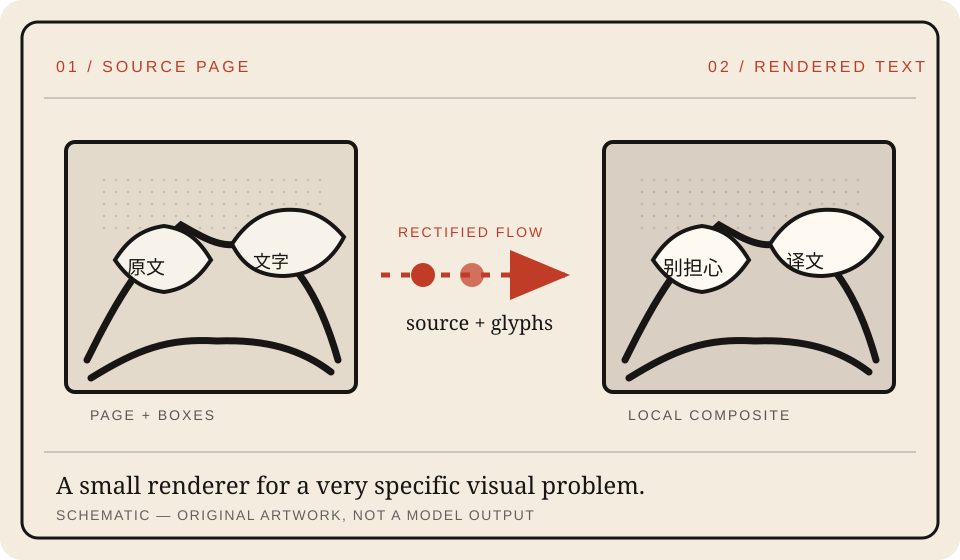

<div align="center">



# MangaTrans-Diffusion

**Give the page its words. Keep its character.**

A diffusion transformer trained from scratch to render supplied Chinese text into manga pages.

[](LICENSE)
[](https://github.com/jomify/MangaTrans-Diffusion/actions/workflows/tests.yml)
[](https://huggingface.co/Jomify/MangaTrans-Diffusion-v3)

[中文说明](README.zh-CN.md) · [Project showcase](https://huggingface.co/spaces/Jomify/MangaTrans-Diffusion) · [Reproduction](docs/REPRODUCING.md)

</div>

MangaTrans-Diffusion takes a page and a list of **text boxes + Chinese strings**,
repaints the lettering regions, and composites the result back onto the source.
Its 119.3M-parameter DiT learns a lettering style from paired pages, using glyph
images to specify the characters to write.

> **Research text renderer.** Detection, translation, and box planning are supplied
> by the caller. The Space is an interactive method showcase, not hosted inference.
> Illustrations are schematic, not model outputs.

| Model | Conditioning | Sampling | Release |
| :--- | :--- | :--- | :--- |
| 119.3M parameters | Source page + glyph image | Rectified flow, overlapping tiles | MIT code + DiT weights |

> **Availability:** Code and v3 weights are live in [GitHub Releases](https://github.com/jomify/MangaTrans-Diffusion/releases/tag/v0.1.0). The Hugging Face model mirror and hosted Space are pending publication.

## Quick start

Python **3.10+**, a **CUDA GPU**, and a Chinese font are required for inference.
Install a CUDA-compatible PyTorch build for your machine, then:

```bash
git clone https://github.com/jomify/MangaTrans-Diffusion.git
cd MangaTrans-Diffusion
python -m venv .venv
# Linux/macOS: source .venv/bin/activate
# Windows PowerShell: .venv\Scripts\Activate.ps1
python -m pip install -r requirements.txt
# Download model.safetensors and config.json from the release into weights/mangatrans-v3/
python translate_page.py page.png examples/regions.json out.png --weights weights/mangatrans-v3
```

Download the two files from [the release assets](https://github.com/jomify/MangaTrans-Diffusion/releases/tag/v0.1.0) before running inference.
Edit `examples/regions.json` to fit **your own input page** before running.
Inference also loads the separately licensed FLUX.1-dev VAE. Obtain access under
its upstream terms, or pass `--vae /path/to/local/vae`. The VAE is not bundled;
see [component terms](weights/README.md#license-and-third-party-components).

Chinese fonts are detected automatically on common systems. To choose one:

```bash
# Linux/macOS
export MTDIFF_FONT=/path/to/NotoSansCJK-Regular.ttc:2
# Windows PowerShell
$env:MTDIFF_FONT = 'C:/Windows/Fonts/msyh.ttc'
```

### Describe the lettering

```json
[
  {
    "box": [812, 140, 868, 420],
    "text": "别担心，我们一起出发吧。",
    "erase": [790, 120, 890, 440]
  }
]
```

| Field / option | Meaning |
| :--- | :--- |
| `box` | `[x0, y0, x1, y1]` in original input pixels. Tall boxes use vertical lettering; wide boxes use horizontal lettering. |
| `text` | The Chinese string to render. The model does not translate it. |
| `erase` | Optional larger rectangle to repaint, such as the original balloon lettering. |
| `--margin 24` | Expand the edit mask around each region before feathering. |
| `--width 1280` | Working page width; use `0` to keep the original dimensions. |
| `--restore-size` | Resize the result to the input dimensions after inference. |
| `--steps 30 --seed 0` | Sampling steps and random seed. |
| `--full-page` | Return the entire model output instead of local compositing. |

Source pixels are retained outside the feathered edit mask **at the working
resolution**. Resizing and feathering can change nearby pixels; this does not
promise byte-identical preservation at the original resolution.
Python entry point: `mtdiff.infer.PageTranslator`.

## Method

```text
Source page ── frozen VAE ── source latent + noise ─┐
                                                 ├─ DiT flow ─ VAE decode ─ local composite
Chinese text + boxes ── glyph rendering ── 8× fold ┘
```

1. **Start near the source.** Sampling starts at the source latent plus 0.5-scaled noise.
2. **Preserve glyph detail.** Text is rendered in a plain font and pixel-unshuffled by eight into 64 conditioning channels, without a VAE round trip.
3. **Learn local lettering.** Targets combine OCR-confirmed Chinese text regions with the Japanese source elsewhere.
4. **Scale to pages.** Overlapping 512 px tiles have predicted velocities averaged at each sampling step, followed by local compositing.

The DiT uses 16 layers, width 768, 12 heads, 2×2 latent patches, 2D rotary
embeddings, QK normalization and adaLN time modulation. The frozen 16-channel
VAE has an 8× spatial stride. Only the DiT is trained from scratch.

## Reported results

Original project records report **215 held-out pages** from unseen works:
**2,864 lines / approximately 14.7k characters**. Reference line regions are
cropped from generated pages and read back using RapidOCR recognition.

| Image under test | CJK character accuracy | Exact lines |
| :--- | ---: | ---: |
| Japanese source page | 4.9% | 0.7% |
| Real-pair training · v2 | 60.7% | 29.0% |
| + Synthetic text variants · v3 | **72.1%** | **46.0%** |
| Chinese reference through the VAE | 98.1% | 94.7% |

These are **historical reported results**, not independently rerun for this
release. Raw evaluation reports and training pages are not bundled. OCR scores
reflect both lettering and recognizer errors, not human readability judgments.
See [the evaluation guide](docs/REPRODUCING.md).

Training used roughly 1.8k real page pairs, then approximately 7k synthetic
variants sampled 1:1 with real data. The v3 package contains float16 EMA weights
exported at step 40,000 (about 239 MB).

## Limitations

- Small text, complex characters and punctuation remain difficult; strokes can jitter.
- Text over screentone or artwork is weaker than text in plain balloons.
- Lettering style is fixed, with no cross-page memory or guaranteed consistency.
- Training used one source of adult manga scanlation pairs. Generalization to all-ages material and other publishers was not separately evaluated.
- This is an experimental renderer; verify all generated text before use.

## Explore the repository

| Path | Purpose |
| :--- | :--- |
| [`mtdiff/`](mtdiff/) | DiT, flow, glyphs, tiling, data and inference |
| [`translate_page.py`](translate_page.py) | Page-rendering CLI |
| [`train.py`](train.py) | Training and EMA checkpoints |
| [`scripts/`](scripts/) | Preparation, caching, evaluation and export |
| [`tests/`](tests/) | CPU regression tests |
| [`showcase/`](showcase/) | Bilingual static Hugging Face Space |
| [`weights/README.md`](weights/README.md) | Model card, provenance and component terms |

```bash
python -m pytest tests -q
python -m http.server 8765 --bind 127.0.0.1 --directory showcase
```

Open `http://127.0.0.1:8765` for a local preview.
See [Reproducing the pipeline](docs/REPRODUCING.md) and [CONTRIBUTING.md](CONTRIBUTING.md).

## License

Original code and released v3 DiT weights use [MIT](LICENSE). The FLUX.1-dev VAE
and fonts retain their own licenses. Training data and derived manga images
are not distributed. See the [model card](weights/README.md).
