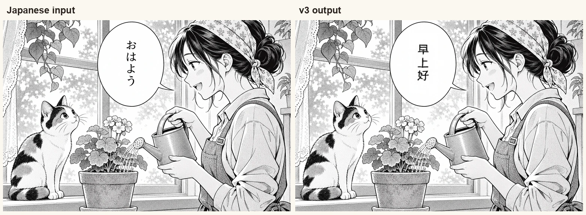
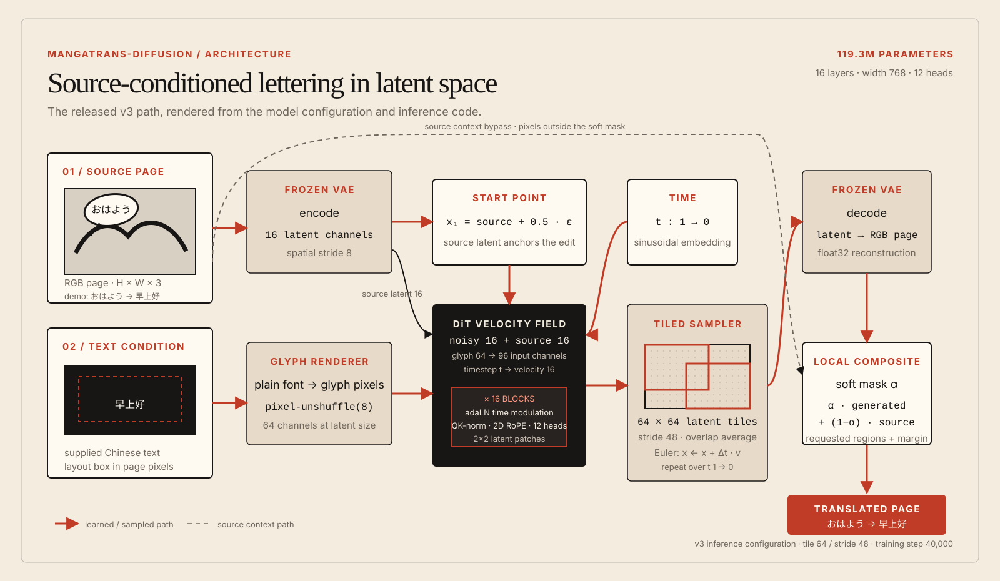

<div align="center">

# MangaTrans-Diffusion

从零训练的 1.193 亿参数扩散 Transformer，为指定漫画区域渲染中文。

[English](README.md) · [模型权重](https://github.com/jomify/MangaTrans-Diffusion/releases/tag/v0.1.0) · [GPU 推理样例](showcase/example/README.md) · [MIT 许可](LICENSE)

</div>

## 翻译前后对比



左图是用 ImageGen 制作的全年龄日文输入页，右图是公开的 v3 权重在 RTX 4060 Laptop GPU 上的实际输出。传入的译文为「早上好」。放大气泡可以看到，中文笔画边缘略有抖动。

[日文输入 PNG](showcase/example/source.png) · [中文输出 PNG](showcase/example/output.png) · [文字与坐标](showcase/example/regions.json) · [复现命令](showcase/example/README.md)

## 架构图

[](showcase/architecture.svg)

输入漫画页和若干组「位置框 + 中文文本」，模型重绘文字区域，再与原图合成。
它用字形图指定要写的内容，从配对页面中学习嵌字风格。

> **这是研究用文字渲染器。** 原文检测、日译中和排版框规划由调用方完成。
> Hugging Face Space 是方法交互展示页，不提供在线推理。

| 主干 | 条件 | 采样 | 开源内容 |
| :--- | :--- | :--- | :--- |
| 119.3M 参数 DiT | 原图 + 字形图 | Rectified flow + 重叠分块 | MIT 代码与 DiT 权重 |

> **发布状态：** 代码和 v3 权重已在 [GitHub Release](https://github.com/jomify/MangaTrans-Diffusion/releases/tag/v0.1.0) 公开；Hugging Face 模型镜像和在线 Space 尚待发布。

## 快速开始

需要 **Python 3.10+、CUDA 显卡和中文字体**。先安装适合设备的 CUDA 版 PyTorch，再执行：

```bash
git clone https://github.com/jomify/MangaTrans-Diffusion.git
cd MangaTrans-Diffusion
python -m venv .venv
# Linux/macOS: source .venv/bin/activate
# Windows PowerShell: .venv\Scripts\Activate.ps1
python -m pip install -r requirements.txt
# 从下方 Release 下载权重和配置，放入 weights/mangatrans-v3/
python translate_page.py page.png examples/regions.json out.png --weights weights/mangatrans-v3
```

请先从 [Release](https://github.com/jomify/MangaTrans-Diffusion/releases/tag/v0.1.0) 下载
`model.safetensors` 和 `config.json`。请先修改 `examples/regions.json`，使坐标适合自己的输入页。

推理需要单独获取 FLUX.1-dev VAE，并遵守上游条款；VAE 不随本项目发布。
可用 `--vae /path/to/local/vae` 指定本地目录。中文字体会自动检测；手动设置示例：

```powershell
$env:MTDIFF_FONT = 'C:/Windows/Fonts/msyh.ttc'
```

Linux 可用 `export MTDIFF_FONT=/path/to/NotoSansCJK-Regular.ttc:2`，末尾数字为字体集合索引。

## 输入格式

```json
[
  {
    "box": [812, 140, 868, 420],
    "text": "别担心，我们一起出发吧。",
    "erase": [790, 120, 890, 440]
  }
]
```

- `box`：原图 `[x0, y0, x1, y1]` 像素坐标；高框竖排，宽框横排。
- `text`：已翻译好的中文，模型不负责翻译。
- `erase`：可选，允许重绘的较大范围，例如原有气泡文字区域。
- `--width 1280`：默认工作宽度；设为 `0` 保持原尺寸。
- `--restore-size`：推理后缩回输入尺寸。
- `--margin 24`：编辑区域外扩后羽化；`--full-page` 使用整页模型输出。
- `--steps 30 --seed 0`：采样步数与随机种子。

默认在**工作分辨率**下保留羽化蒙版外的原图像素；缩放和羽化仍会影响像素，
不保证与原始尺寸输入逐像素一致。Python 接口为 `mtdiff.infer.PageTranslator`。

## 方法

1. 原图经过冻结的 16 通道 VAE，得到下采样 8 倍的隐变量。
2. 中文按指定框渲染为字形图，再按 8×8 折叠为 64 通道，不经过 VAE。
3. DiT 从「原图隐变量 + 0.5 倍噪声」出发，学习文字区域的变化。
4. 整页按 512 像素重叠分块，每步平均重叠区域的速度预测，最后局部合成。

主干为 16 层、768 维、12 头、2×2 隐空间 patch，采用二维旋转位置编码、QK 归一化和 adaLN。
从零训练的是 DiT，VAE 使用冻结的预训练权重。目标图仅在 OCR 确认的文字区域取中文页，其余取原图。

## 原项目记录的评测

验证集为未见过的作品，共 **215 页、2,864 行、约 1.47 万字**。从生成页裁出参考行，用 RapidOCR 读回：

| 被测图像 | 汉字准确率 | 整行全对 |
| :--- | ---: | ---: |
| 日文原图 | 4.9% | 0.7% |
| 仅真实配对 · v2 | 60.7% | 29.0% |
| 加合成变体 · v3 | **72.1%** | **46.0%** |
| 中文参考页经 VAE | 98.1% | 94.7% |

这些是**历史记录指标**，此次开源没有重跑完整评测，也没有打包原始评测报告。
OCR 分数受渲染和识别器误差共同影响，不等于人工可读性评价。
训练记录为约 1,800 页真实配对，加约 7,000 个合成变体，以 1:1 比例采样继续训练。
v3 权重在第 40,000 步导出，为 float16 EMA，约 239 MB。

## 局限与来源

小字、多笔画字和标点易出错，笔画边缘会抖动；网点或画面上的文字比纯色气泡更难处理。
没有跨页记忆和可控的多种嵌字风格。训练来自单一来源的成人漫画汉化配对，
未单独验证全年龄漫画和其他出版来源的泛化效果。请逐字检查输出。
训练数据及衍生漫画图像**不随仓库发布**。

## 开发与许可

```bash
python -m pytest tests -q
python -m http.server 8765 --bind 127.0.0.1 --directory showcase
```

在 `http://127.0.0.1:8765` 预览展示页。核心实现见 `mtdiff/`，训练入口为 `train.py`。
完整步骤见[复现说明](docs/REPRODUCING.md)，协作说明见 [CONTRIBUTING.md](CONTRIBUTING.md)。

原创代码和 v3 DiT 权重使用 [MIT](LICENSE)。第三方 VAE、字体和训练数据不在该许可范围内，
详见[模型说明](weights/README.md)。
