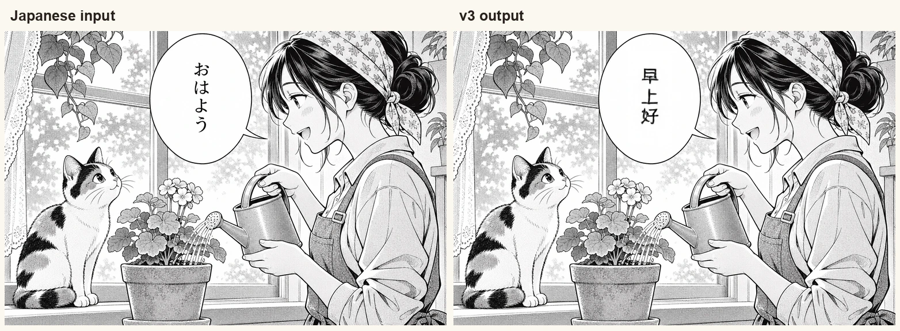

# MangaTrans-Diffusion · v3

**A 119.3M-parameter diffusion transformer for rendering supplied Chinese text into manga pages.**

[Source code](https://github.com/jomify/MangaTrans-Diffusion) ·
[Project showcase](https://huggingface.co/spaces/Jomify/MangaTrans-Diffusion) ·
[中文说明](https://github.com/jomify/MangaTrans-Diffusion/blob/main/README.zh-CN.md)

## Japanese input and v3 output



The supplied translation for **おはよう** is **早上好**. The right panel was produced by the published checkpoint. [Inference recipe and full-resolution files](https://github.com/jomify/MangaTrans-Diffusion/tree/main/showcase/example) · [Model architecture](https://github.com/jomify/MangaTrans-Diffusion/blob/main/showcase/architecture.svg)

## Model details

| Item | Value |
| :--- | :--- |
| Architecture | Custom DiT, 16 layers, width 768, 12 heads |
| Parameters | 119.3 million |
| Condition | Source latent + glyph image (64 folded channels) |
| Objective | Rectified flow starting from source + 0.5-scaled noise |
| Image codec | Frozen FLUX.1-dev VAE, 16 latent channels, stride 8 |
| Inference tiles | 64 latent pixels / 48 stride (512 / 384 image pixels) |
| Export | v3 step 40,000, float16 EMA weights |
| Files | `model.safetensors` (~239 MB), `config.json` |

This custom model loads through the project's `PageTranslator`, **not** a
standard Diffusers or Transformers pipeline. Only the DiT was trained from
scratch. The VAE is a separate pretrained dependency and is not included.

## Intended use

Research on typesetting-aware image editing. The caller supplies the source
page, Chinese strings, layout boxes and optional erase boxes. OCR, translation,
and layout planning are outside this model. This is not a production translation
system. The Space is a static method showcase, not live inference.

## Download and run

```bash
git clone https://github.com/jomify/MangaTrans-Diffusion.git
cd MangaTrans-Diffusion
python -m pip install -r requirements.txt
hf download Jomify/MangaTrans-Diffusion-v3 model.safetensors config.json --local-dir weights/mangatrans-v3
python translate_page.py page.png regions.json out.png --weights weights/mangatrans-v3
```

Use Python 3.10+, CUDA, and a Chinese font. Obtain the VAE separately under its
upstream terms; `--vae /path/to/vae` selects a local VAE directory.
See the source README for region format, font selection and compositing behavior.

## Training and evaluation

The project records describe roughly 1.8k real aligned Japanese/Chinese page
pairs, followed by approximately 7k synthetic text variants sampled 1:1 with
real pairs. The training source consists of copyrighted adult manga scanlation
editions. Training pages, OCR text, latent caches, and derived manga images are
not distributed. The model license does not grant permission to redistribute
those materials.

Historical evaluation uses 215 held-out pages from unseen works, 2,864 lines and
approximately 14.7k characters. Reference line crops from generated pages are
read back with RapidOCR recognition.

| Image | CJK character accuracy | Exact lines |
| :--- | ---: | ---: |
| Japanese source | 4.9% | 0.7% |
| v2 · real pairs only | 60.7% | 29.0% |
| v3 · real + synthetic | **72.1%** | **46.0%** |
| Chinese reference through VAE | 98.1% | 94.7% |

These are historical project-reported results. Raw evaluation artifacts are not
included and the full evaluation was not rerun during release preparation.
OCR scores combine rendering and recognizer errors; they are not a human
readability rating or a generalization guarantee.

## Limitations

- Small text, complex characters and punctuation can be incorrect; strokes jitter.
- Text over screentone or artwork is weaker than text inside plain balloons.
- No cross-page consistency mechanism or controllable lettering style.
- One training source; other publishers and all-ages material were not separately evaluated.
- The model inherits a visual prior from adult material. Inspect outputs and use only input material you are authorized to process.

## License and third-party components

The publisher releases original code and these v3 DiT weights under **MIT**;
see `LICENSE` in the code/model repositories. The publisher has confirmed
authorization to release these weights. These components retain their own
terms and are not relicensed or bundled by this project:

- **VAE:** the config references [`black-forest-labs/FLUX.1-dev`](https://huggingface.co/black-forest-labs/FLUX.1-dev), subfolder `vae`. Review its [upstream license](https://huggingface.co/black-forest-labs/FLUX.1-dev/blob/main/LICENSE.md) and access conditions separately. The project's MIT grant does not override upstream VAE terms.
- **Fonts:** Noto CJK uses SIL OFL. Historical synthetic training also used WenQuanYi and Arphic fonts under their respective licenses. Fonts are not bundled.
- **Data:** training pages and their derivatives are not licensed or distributed by this release.
